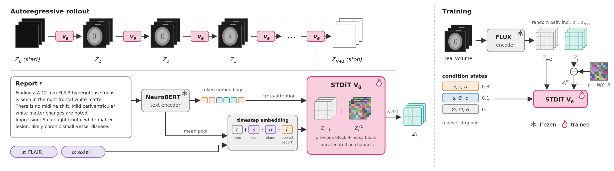
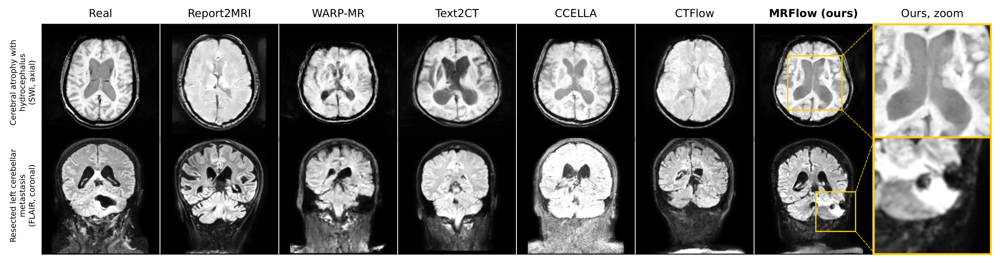

# MRFlow

**MRFlow: Report-Conditioned Autoregressive Flow Matching for Variable-Length 3D Brain MRI.**

[](#)
[](https://huggingface.co/teodora-spasojevic-fau/MRFlow)
[](https://huggingface.co/datasets/Forithmus/MR-RATE)
[](LICENSE)

MRFlow is a report-conditioned autoregressive flow-matching model for multi-sequence, multi-plane 3D
brain MRI generation. A Spatial-Temporal DiT generates the series block by block in FLUX-VAE latent
space, so the series length is not fixed. Each block is conditioned jointly on the previous block,
the report (at the token and pooled level), the sequence type and the acquisition plane. The report
is encoded by NeuroBERT fine-tuned on MR-RATE reports, and hierarchical classifier-free guidance is
applied over sequence type and report.

## Method



## Results

Image quality on 1,000 MR-RATE test series (100 per sequence-plane combination), ± bootstrap
standard deviation. cfg: guidance scales for sequence/report.

| Method | FVD<sub>16</sub> ↓ | FVD<sub>64</sub> ↓ | FID-2D ↓ | FID-2.5D ↓ |
|---|---|---|---|---|
| NV-Generate-MR-Brain | 282.8 ± 13.5 | 547.0 ± 21.9 | 21.13 ± 0.52 | 0.454 ± 0.015 |
| WARP-MR, cfg 5 | 229.6 ± 10.4 | 320.4 ± 10.1 | 38.15 ± 0.53 | **0.120 ± 0.004** |
| Report2MRI, cfg 10/4 | 194.6 ± 5.5 | 454.5 ± 14.3 | 25.70 ± 0.40 | 0.827 ± 0.032 |
| Text2CT, cfg 10 | 222.6 ± 10.0 | 353.3 ± 13.2 | 16.15 ± 0.35 | 0.203 ± 0.006 |
| CCELLA, cfg 4 | 177.8 ± 8.7 | 306.3 ± 12.8 | 22.60 ± 0.71 | 0.395 ± 0.018 |
| CTFlow, cfg 1/1 | 171.4 ± 9.8 | 203.8 ± 10.4 | 21.16 ± 0.38 | 0.190 ± 0.006 |
| MRFlow, cfg 1/1 | 101.1 ± 6.4 | 140.9 ± 8.1 | 14.12 ± 0.30 | 0.159 ± 0.005 |
| **MRFlow, cfg 3/3** | **78.3 ± 5.4** | **102.9 ± 6.1** | **10.55 ± 0.25** | 0.154 ± 0.006 |

Pathology classification (14 MR-RATE groups): a 3D classifier is trained on real and/or
MRFlow-generated series (generated from the same 4,000 training reports) and always tested on
4,879 real test studies. Macro AUROC [95% CI], and the difference to training on 4,000 real series.

| Classifier training data | AUROC ↑ | ΔAUROC ↑ |
|---|---|---|
| 4,000 real | 0.701 [0.689, 0.712] | – |
| 4,000 generated | 0.707 [0.695, 0.718] | +0.006 [−0.003, +0.017] |
| 4,000 real + conventional augmentation | 0.717 [0.707, 0.728] | +0.016 [+0.009, +0.024] |
| **4,000 real + 4,000 generated** | **0.731 [0.720, 0.742]** | **+0.030 [+0.023, +0.040]** |
| 69,436 real (upper bound) | 0.800 [0.790, 0.809] | +0.099 [+0.087, +0.112] |

Generated series for two test reports (an SWI axial and a FLAIR coronal series). Each method gets the
same report, sequence and plane. The real series is on the left and the last column zooms into
the MRFlow pathology described in the report.



## Installation

The FLUX VAE comes from [FLUX.1-schnell](https://huggingface.co/black-forest-labs/FLUX.1-schnell),
a gated repository: accept its license on the model page and log in with `hf auth login` first.

```bash
python -m venv venv && source venv/bin/activate
pip install -r requirements.txt
export PYTHONPATH=$PWD

# MRFlow denoiser, config and fine-tuned NeuroBERT; FLUX VAE
hf download teodora-spasojevic-fau/MRFlow --local-dir models/
hf download black-forest-labs/FLUX.1-schnell --include 'vae/*' --local-dir models/flux
sed -i "s#/path/to/flux-vae#$PWD/models/flux/vae#; s#null_text: .*#null_text: $PWD/models/null_text.pt#" models/config.yaml
```

## Data format

Training reads pre-encoded latents and report embeddings. `mrflow/mri.py` has the functions we used for MR-RATE: `preprocess_volume` (RAS reorientation, 1 mm resampling, [0, 1] normalization, 256 × 256 crop), `encode_volume`,
`encode_boundary` and `LatentStore`.

- **Latents** (`.pt`): one per series, FLUX-VAE posterior mean and std concatenated on the channel
  axis, shape `[32, T, 32, 32]`, fp16, unscaled. `T` is the number of slices which varies, but must be at least 32 (two blocks).
- **Report embeddings** (`.pt`): one per report, as written by `encode_neurobert_tokens`.
- **Boundary latents**: `<dataset_root>/boundary/{black,white}.pt`, from `encode_boundary(vae, 0)`
  and `encode_boundary(vae, 1)`.
- **Manifest**: CSV files in `<dataset_root>/manifest/` with columns `sample_id, split, modality,
  plane, n_slices, latent_path, embedding_path, zip`. Paths are relative to the root, or members of
  the zip in `zip` when it is set. Optional `trim_start, trim_stop, source_slices` columns keep
  only part of each latent. `modality` is one of T1w, T2w, FLAIR, SWI, MRA; `plane` one of
  AXIAL, SAGITTAL, CORONAL.

Set `mri.dataset_root` to this directory. Embeddings can live in a separate directory
(`mri.embedding_root`) with its own `manifest/` CSVs (`sample_id, split, embedding_path, zip`),
matched to the series by `sample_id`.

## Generation

```bash
python scripts/generate.py --config models/config.yaml --ckpt models/denoiser_ema \
    --embedding report.pt --modality FLAIR --plane AXIAL \
    --modality-cfg-scale 3 --report-cfg-scale 3 --output out/
```

`report.pt` is the report encoded by the fine-tuned NeuroBERT:

```python
import torch
from mrflow.text import load_neurobert, encode_neurobert_tokens

model, tokenizer = load_neurobert("cuda")
report = {"findings": "...", "impression": "..."}
torch.save(encode_neurobert_tokens(model, tokenizer, report), "report.pt")
```

`--type gt-head` and `--type block-wise` start
from or condition on real blocks given by `--gt-latent`.

## Training

```bash
accelerate launch --num_processes 4 --multi_gpu --mixed_precision bf16 \
    scripts/train.py --config configs/mrflow.yaml
```

The released model was trained from scratch for 180k steps on 64 H200 GPUs (effective batch size
2,048). Training resumes from the latest checkpoint in `output_dir`.

## Acknowledgements

MRFlow builds on [CTFlow](https://github.com/WongJiayi/CTFlow). The files adapted from it are marked in
their headers. We thank the authors of [MR-RATE](https://huggingface.co/datasets/Forithmus/MR-RATE), [NeuroBERT](https://huggingface.co/davvwood/NeuroBERT) and [FLUX](https://huggingface.co/black-forest-labs/FLUX.1-schnell) for releasing their data and models.

## Citation

```bibtex
TBA
```

Please also cite CTFlow:

```bibtex
@InProceedings{Wang_2025_ICCVW,
    author    = {Wang, Jiayi and Reynaud, Hadrien and Erick, Franciskus Xaverius and Kainz, Bernhard},
    title     = {CTFlow: Video-Inspired Latent Flow Matching for 3D CT Synthesis},
    booktitle = {Proceedings of the IEEE/CVF International Conference on Computer Vision (ICCV) Workshops},
    year      = {2025},
}
```

and MR-RATE:

```bibtex
@misc{mrrate,
    title  = {{MR-RATE}},
    author = {{Forithmus}},
    year   = {2026},
    url    = {https://huggingface.co/datasets/Forithmus/MR-RATE},
}
```
